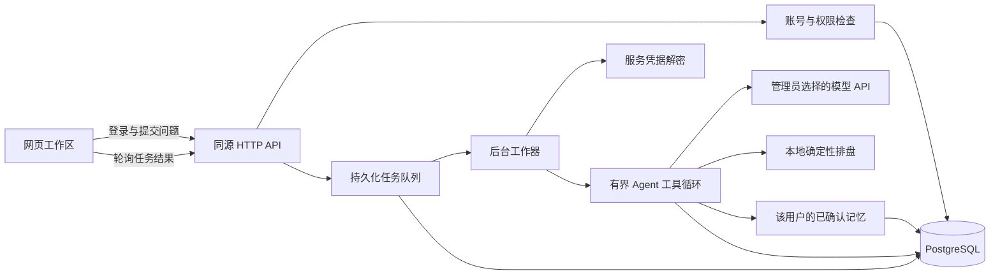

# 观星 V3.1 Agent 架构

观星复用同一套排盘、界面和 Agent 运行器，支持静态体验、本地工作区和独立服务器网站。服务器版新增多用户、服务密钥管理和持久化任务；当前没有支付或打赏模块。

| 模式       | 入口与身份           | 模型调用                         | 数据持久化              |
| ---------- | -------------------- | -------------------------------- | ----------------------- |
| 静态页面   | 无工作区账号         | 浏览器使用访客临时 Key 直连模型  | 不提供业务数据库        |
| 本地工作区 | 单管理员登录         | 同源后端使用本次临时 Key         | 本机 PostgreSQL         |
| 服务器网站 | 管理员和普通用户账号 | 后台任务使用管理员配置的加密 Key | PostgreSQL 中按用户隔离 |

`APP_MODE=public` 启用服务器版 API；未启用时保持本地工作区入口。GitHub Pages 仍提供静态体验，无法承载数据库和后台任务。

## 模块与职责

| 模块                                        | 职责                                                                                |
| ------------------------------------------- | ----------------------------------------------------------------------------------- |
| `src/App.tsx`、`src/CelestialAtmosphere.tsx` | 动态封面、路由与服务模式识别。                                                      |
| `src/chart-ui.tsx`、`src/lib/chart.ts`      | 出生信息、十二宫展示与确定性排盘。                                                  |
| `src/ReadingRoom.tsx`                     | 用户排盘、自由对话、历史解读与自己的账号和记忆。                                    |
| `src/Workspace.tsx`、`src/workspace-api.ts` | 管理后台与前后端接口；普通用户先检查身份，无后台访问权限。                          |
| `server/index.ts`                           | 服务启动、模式选择；保留本地单管理员同步运行 API。                                  |
| `server/public-server.ts`                   | 服务器版账号、权限、模型凭据、任务与管理 API。                                      |
| `server/http.ts`                            | 请求校验、密码散列、会话 Cookie、命盘和模型输入校验。                               |
| `server/jobs.ts`                            | 从数据库领取任务、执行 Agent、响应停止、恢复中断状态。                              |
| `server/agent.ts`                           | 上下文拼装、受限工具循环、模型调用、预算预留和结算。                                |
| `server/vault.ts`                           | 模型 Key 的 AES-256-GCM 加密与解密。                                                |
| `server/store.ts`                           | 数据迁移、按用户限定的参数化查询、任务入队和用量存储。                              |
| `server/types.ts`、`server/public-types.ts` | 运行、账号、任务与站点设置的数据契约。                                              |
| `server/embedding.ts`                       | 尚未配置服务的 embedding 接口边界，当前不发出向量模型请求。                         |

架构参考见 [Harness 参考说明](harness-references.md)。观星没有嵌入 DeepSeek Harness 官方运行时。

## 账号与访问边界

首次创建服务器版管理员必须提供部署时生成的 `SETUP_TOKEN`；仅知道网站地址不能初始化管理员。密码使用随机盐与 scrypt 保存，数据库只保存登录会话散列。业务 API 使用 HttpOnly、SameSite=Strict Cookie，HTTPS 登录附带 Secure 标记，并校验 Host 和写操作的 Origin。

服务器版默认关闭注册，管理员可在站点管理中开放注册、设置每人每日 1—100 次提交额度、停用用户和重置密码。默认每日额度为 10 次。密码修改或账号停用会撤销旧会话，停用账号还会取消其排队任务并请求中止正在执行的任务。

每次请求根据登录账号建立 `Store.forUser(user.id)`。会话、消息、运行、记忆、检索、任务、用量及业务导出均带用户范围，不能只凭前端传入的记录 ID 读取数据。模型服务配置和站点设置是管理员维护的站点级资源；普通用户只取得可用模型的必要展示信息，不取得网关、价格配置或密钥。

管理员可查看全站统计及调用账本，管理接口不提供直接读取其他账号聊天、命盘或记忆的入口。这不等于数据对运营者保密：管理员可重置密码，服务器和数据库管理者可以访问数据库或备份。详细说明见 [数据流与隐私](privacy.md)。

旧本地数据库迁移时，将原管理员和历史数据归入 `owner` 账号，不清空原会话、记忆或账本。

## 服务器版的一次解读

1. 用户提交问题、模型 ID 和请求标识，后端检查账号、会话归属、模型可用性和站点额度。普通用户不提交 API Key。
2. 入队事务检查同账号请求标识，重复提交相同内容会返回原任务；同标识对应不同内容则拒绝。事务同时限制每个用户一个活动任务、个人当日提交次数和全站活动任务总量。
3. API 返回任务 ID，网页轮询进度。任务已经写入 PostgreSQL，刷新、关闭页面或退出登录不会取消。
4. 工作器领取排队任务，重新检查账号和模型，解密站点 Key，再使用该用户的数据范围执行 Agent。
5. Agent 的回复、运行、记忆候选和调用账本写入数据库，任务随后标记为完成；网页读取并展示保存的结果。
6. 点击停止会持久化取消请求，并通知当前工作器。已开始的模型调用可能已经产生费用，取消不会删除其用量。

当前针对 2GB 服务器采用**全站一个实际运行中的模型任务**，其他请求进入队列，不占用长连接等待。工作器通过 PostgreSQL advisory lock 防止多个进程同时执行模型任务；领取队列记录使用行锁和 `SKIP LOCKED`。每个用户最多一个排队或执行中的任务，全站默认最多 100 个活动任务。

同一个执行锁也保护模型配置变更和每日模型预算的检查、预留顺序。增加进程副本不会自动增加模型并发；如以后提高执行并发，需要先调整原子预算预留和任务隔离策略。

工作器重启后继续处理尚未开始的排队任务。取得执行锁后，会将旧的运行中任务标记为失败或已取消，保留已经发生的用量；不会自动重跑并产生重复模型费用。这是持久队列与失败恢复，不是模型执行中途的断点续算。

## 本地工作区的运行方式

本地模式保持单管理员使用。浏览器把问题、模型 ID 和当前页面临时 Key 发给本机后端，等待同一 HTTP 请求返回。停止或页面连接断开会尝试取消运行，与服务器版的持久后台任务不同。

本地配置仍默认只绑定回环地址，数据库没有宿主机端口。服务器网站应使用专用的 `compose.server.yaml` 和公开模式，不能将本地单管理员接口直接当成多用户网站开放。

## Agent 工具与解读规则

一次运行最多 5 次模型请求，每步最多 4 次工具调用，每次运行最多提出 3 条候选记忆。运行器超时 120 秒，工作器另有 125 秒的外层停止保护；每步输出上限为 2,600 tokens，实际可能因预算缩小。初始上下文包含最近 12 条消息和最多 8 条已确认记忆。

工具仅有：

- `get_chart`：根据会话中保存的真实命盘输入排盘。
- `search_memory`：在当前用户范围内查询已确认记忆。
- `propose_memory`：写入等待用户确认的记忆候选。

工具调用不能变成任意 Shell、浏览器操作或 SQL。公开服务通过 DeepSeek 官方域名调用时，显式关闭默认思考模式，以控制初期输出预算；这不代表所有兼容网关都支持或使用相同参数。模型的调用能力仍需以实际服务验证。

界面分为动态封面、`/#reading` 用户页面与 `/#admin` 管理后台。旧 `/#agent` 兼容进入用户页。普通用户不展示工具循环、模型配置或用量账本，后台仍执行同一运行器。首次发送问题时自动创建关联当前命盘的会话，历史解读打开时恢复对应命盘。静态版也传递最近 12 条对话，但不持久化。

三种模式共用 `src/lib/reading-style.ts`：先给结论，用日常语言解释依据，不主动反问、不布置反思题。不限制固定篇幅、标题和话题顺序；追问承接前文，不重新输出整篇报告。具体问题只回答相关部分，术语出现时解释，缺少流年资料时不编造具体年份事件。命盘推论不会被自动当成已确认个人事实。

## 数据与记忆

| 数据                           | 用途                                                                      |
| ------------------------------ | ------------------------------------------------------------------------- |
| `accounts`、`auth_sessions`    | 账号角色、密码散列、停用状态和登录会话；`owner_auth` 保留旧本地模式兼容。 |
| `sessions`、`messages`、`runs` | 按用户保存的命盘输入、聊天和运行记录。                                    |
| `memories`                     | 按用户保存正文、会话范围、确认状态和可选向量。                            |
| `models`、`model_credentials`  | 模型服务配置与独立保存的凭据密文。                                        |
| `agent_jobs`                   | 持久任务、请求标识、问题、状态、结果和取消标记。                          |
| `usage_ledger`                 | 每次模型调用的输入、输出、费用估算、来源与状态。                          |
| `site_settings`                | 注册开关和用户每日提交额度。                                              |

检索只读取 `active` 记忆，并限于当前会话及**该用户自己的跨会话记忆**。手动填写的记忆直接确认，模型建议先进入候选区。编辑正文会清除旧 embedding。

pgvector 已实现 768 维字段、余弦距离查询和 HNSW 索引，但当前未接入 embedding provider，不下载或运行本地模型。正常检索使用文本匹配及近期已确认记忆，不应宣传为已启用语义检索。

删除会话会删除相关消息、运行和会话记忆；跨会话记忆单独管理。调用账本保留并解除会话关联。服务器版任务保留用于次数统计的记录，同时清空该会话任务的问题和结果，因此删除会话不会恢复当天额度。删除记忆不会自动改写历史对话或已生成任务结果。

## 模型凭据与部署

静态版和本地工作区的临时 Key 不写入数据库或浏览器持久存储。服务器版由管理员在网页中配置 Key，用 AES-256-GCM 加密后保存，模型 ID 作为附加认证数据绑定密文。主密钥 `APP_SECRET` 是持久的 32 字节密钥，保留在服务器配置中；API 不回显明文或密文，普通用户导出也不包含凭据。

服务器版拒绝配置公开 HTTP 来源，正式域名通过 HTTPS 使用。尚未配置域名时，可通过 localhost 的 SSH 隧道初始化和试用。数据库不开放公网端口。主密钥和数据库需配套备份，重建容器不应重建主密钥。

部署步骤见 [服务器部署](server-deployment.md)；本机体验见 [本地部署](local-deployment.md)。

## 用量与预算

个人提交额度与模型用量账本分开：前者统计当日已经提交的任务，成功、失败和停止均计入；后者记录每次实际发起的模型调用，包括工具循环里的多次调用。请求标识去重不会增加个人次数。

每个共享模型必须配置大于零的全站每日 token 上限，费用上限可选。模型请求前，运行器以输入 UTF-8 字节数加 1,024、再加最大输出额度作保守预留；随后按服务商返回的 usage 结算。无明确 usage 的失败或中断保留估算或未知记录，不能展示成服务商确认的精确用量。

每日归属默认使用 `Asia/Shanghai`。费用按管理员填写的输入和输出单价估算，USD 与 CNY 分开累计。当前没有自动同步服务商价格、缓存命中优惠或峰谷计价，也没有面向用户的收费、充值、订单或支付账本；管理台金额用于控制站点支出，不等于服务商最终账单。
