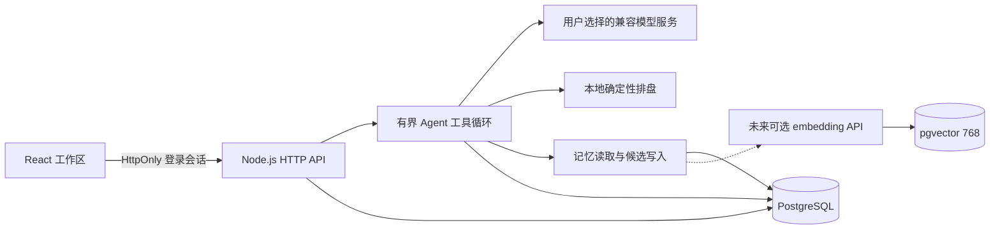

# 观星本地 Agent 架构

观星的静态页面负责排盘与展示。本地工作区增加一个同源 Node.js 服务，将多轮对话、工具、记忆和用量串起来。PostgreSQL 保存业务数据，pgvector 保存可选的 768 维记忆向量。它是单人工作区，不是多租户云服务。

## 模块

| 模块 | 职责 |
| --- | --- |
| `src/App.tsx`、`src/lib/chart.ts` | 展示星图、收集排盘输入，调用确定性排盘引擎。 |
| `src/Workspace.tsx`、`src/workspace-api.ts` | 工作区登录、会话、记忆、模型与用量操作；只调用同源 `/api`。 |
| `server/index.ts` | HTTP 路由、首次设置和登录、会话认证、静态文件服务、请求取消。 |
| `server/agent.ts` | 模型请求、工具循环、上下文拼装、运行限制、用量结算。 |
| `server/store.ts` | 数据迁移、参数化 SQL、对话/记忆/配置/用量存储、向量检索。 |
| `server/types.ts` | 前后端数据契约。 |

设计参考和未实现的官方能力见 [Harness 参考说明](harness-references.md)。观星没有嵌入 DeepSeek Harness 的官方运行时。

## 一次对话如何完成

1. 浏览器发送问题、所选模型 ID 和本次临时 Key。服务端检查登录、模型启用状态与预算。
2. 读取当前会话、已附带的命盘输入和可用的已确认记忆，组成有界上下文。
3. 模型可以返回文本或请求受支持的工具。工具读取本地命盘或记忆，返回结构化结果；运行器将工具结果交回模型继续推理。
4. 每次模型调用分别记入 token/费用账本，多步工具循环不会只计最后一次调用。
5. 最终回复、运行状态和工具活动保存到 PostgreSQL。模型建议保存的新记忆进入待确认状态。
6. 用户停止或浏览器断开时，将取消信号交给正在运行的请求；失败和取消使用各自的状态，不展示为成功结果。

当前循环最多 5 步，每步最多 4 次工具调用，单次运行最多提出 3 条候选记忆。整次运行超时 120 秒，每步模型输出上限 1,600 token，初始上下文使用最近 12 条消息和最多 8 条已确认记忆。运行器只注册 `get_chart`、`search_memory` 和 `propose_memory` 三种工具；模型输出不能变成任意 Shell、浏览器操作或数据库 SQL。

## 数据与记忆

- `sessions`、`messages`：会话、可选命盘输入和对话正文。
- `runs`：每次运行的状态、步数、错误摘要与工具事件。
- `models`：服务地址、模型名、启用状态、价格和预算，不含 API Key。
- `memories`：正文、所属会话或全局范围、`pending`/`active` 状态与可选向量。
- `usage_ledger`：逐次模型调用的 token、费用估算、币种、来源及状态。
- `owner_auth`、`auth_sessions`：管理员认证与登录状态；不包含在业务导出里。

检索只使用 `active` 记忆，并限制在当前会话及全局记忆范围。手动添加的记忆可以直接确认；模型推断需要人工确认。编辑正文会清除旧 embedding，避免旧向量继续代表新文本。

pgvector 的向量字段和检索路径已实现，但默认不配置 embedding API，也不部署或下载任何模型。当前使用文本匹配与近期已确认记忆。以后接入 embedding API 时，使用 768 维向量与余弦距离检索；向量索引不替代原文，也不保证检索内容真实或完整。

删除会话会连同相关消息、运行和该会话的记忆一起删除。用量账本保留，解除会话关联，以便预算不会被删除会话重置。全局记忆需要在记忆页单独管理。

## 模型密钥与持久化边界

公开静态模式下，页面临时 Key 直接用于用户选择的模型接口；本地工作区则先送到同源后端，再由后端调用所选服务。两条路径都不把 Key 写入数据库或本地持久存储。刷新页面后需要重新输入。

本地工作区会保存用户主动发送的聊天和附带的命盘，不能沿用静态模式“不保存历史命盘”的描述。会话数据只在自己的数据库里持久化，发给模型的上下文仍可能包含用户问题、对话历史、相关记忆和命盘信息；点击发送即会交给所选模型服务处理。用户应通过模型配置选择自己信任的服务。

首次管理员设置仅允许执行一次。其余业务 API 使用 HttpOnly 登录会话。Compose 只将应用映射到 `127.0.0.1`，数据库通过容器网络连接。部署配置见 [本地运行](local-deployment.md)。

## 用量与费用

模型响应提供的 usage 优先使用；缺失时明确标记估算或未知，不能显示为服务商确认的精确账单。费用按模型配置里的输入/输出单价计算。USD 与 CNY 分开累计，不做隐式汇率换算。请求前先写入保守预留用量，减少中途失败或进程重启绕过预算的可能。成功后按 provider usage 结算；未返回 usage 时保留估算。失败、超时且实际用量不明时使用保守记账，并标记 `unknown`，不把预留数冒充服务商返回的精确 token。

每日预算按 UTC+8 归日，用于限制继续发起调用。发起请求前的 token 检查采用输入 UTF-8 字节数加 1,024 的保守预留，再计入最大输出额度。最终计费仍由服务商决定；平台统计和价格设置是本地管理工具，不等于服务商账单。

## 运行形态

- GitHub Pages：保留静态排盘与访客自带 Key 的体验。访问本地工作区功能时提示启动本机服务。
- Docker 本地版：Node.js 同时提供构建后的页面和 API；PostgreSQL + pgvector 随 Compose 启动。
- 默认无模型部署：模型及临时 API Key 由用户之后在页面配置；向量存储就绪，未配置 embedding 时使用文本/近期记忆检索。
