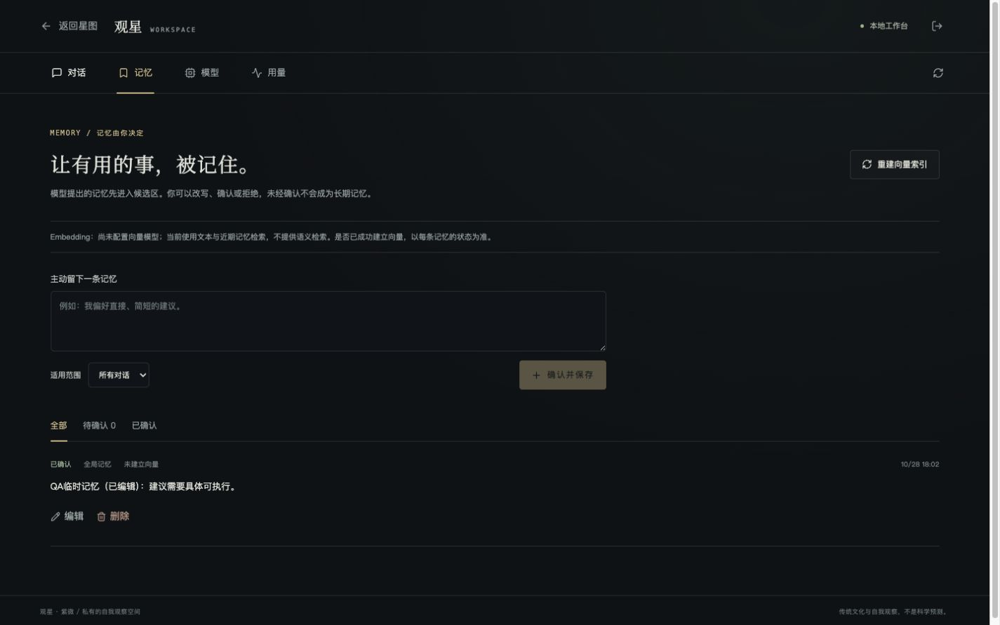
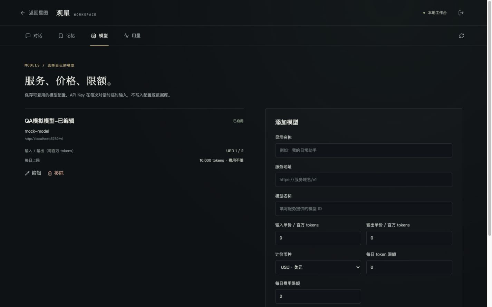
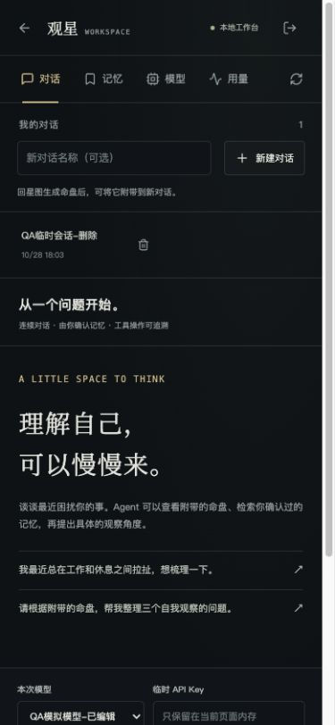
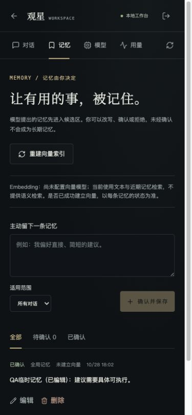
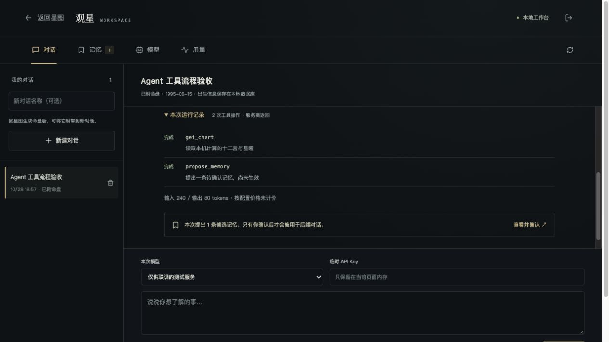
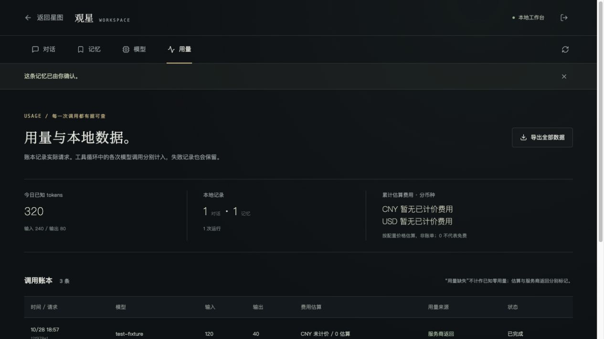

# 工作台界面验收记录

日期：2026-10-28。环境：本机 Vite、Node API、可丢弃 PostgreSQL 测试库。使用已存在的测试管理员账号；没有设置或更改用户的真实密码，没有调用付费模型。

## 已核验

| 场景 | 结果 |
| --- | --- |
| 无 API 的公开页面 | 显示本地启动说明与 `./scripts/start-local.sh`，没有伪造后台数据 |
| 管理员登录 | 登录后读取真实会话、记忆、模型及用量 |
| 会话 | 界面创建成功，重新读取后消息仍在；测试结束由 API 清理 |
| 主动记忆 | 界面添加、编辑、删除成功，数据保存在本地数据库 |
| 候选记忆 | 使用真实 API 建立 pending 测试项；界面明确等待确认，确认后转为 active，待确认计数归零 |
| 未配置 embedding | 重建索引明确提示服务尚未配置；页面说明使用文本与近期记忆，不宣称语义检索 |
| 模型配置 | 界面新增、编辑、保存 token 限额成功；Key 没有进入模型配置 |
| 请求失败 | 本地模拟服务返回 HTTP 400 后，界面显示错误、保留问题及失败运行记录 |
| 用量账本 | 失败请求来源为 unknown；无预留数时显示 `—` / 无法确认，有正数预留时明确标注预留，没有伪造已知用量 |
| 导出 | 界面触发导出并显示完成提示；单独核对 API 导出结构包含会话、运行、消息、记忆、用量与模型，不含认证或模型密钥 |
| 移动端 | 在 390 × 844 视口检查对话、记忆、模型与用量页面，没有整页横向溢出；账本在容器内横向滚动 |
| 桌面端 | 在 1440 × 900 视口检查侧栏、对话输入与管理布局 |

类型检查 `npx tsc -b` 通过。API 客户端针对同源凭据、路径编码、JSON 请求、非 JSON 404、401 和 AbortController 的检查通过。

## 本轮修正

- 手机返回按钮保留可访问名称。
- 切换页签清除上一页的临时提示。
- 将聚合数据标为“今日记账 tokens”，说明包含服务商返回、估算和预留；未核实的正数标注预留，费用汇总明确为今日估算。用量缺失不是已知零用量。
- 会话和模型删除改为页面内 HTML 对话框确认，避免阻塞式原生确认框。对话框支持键盘取消、焦点管理与请求中禁用。
- 记忆保存失败时保留编辑草稿；登录失效清除临时 Key。

## 验证边界

初轮旧模拟服务用于静态命盘请求，其 HTTP 400 是模拟协议不匹配，用于检验失败分支。随后在独立测试端口与适配 Agent 的本地 HTTP fixture 上复验：浏览器发送问题，真实运行器调用 get_chart / propose_memory，再继续请求测试服务并显示回复；界面显示两次工具操作、待确认记忆、两笔服务商格式 usage。点击确认后 pending 计数归零，用量页显示输入 240 / 输出 80。测试服务没有实际模型能力，也未产生收费调用。

新的页面内删除确认已在内置浏览器复验打开与取消，焦点落在取消按钮，取消后原会话保留；底层删除及账本保留另由数据库集成测试覆盖。取消运行由自动测试覆盖，未宣称流式输出（当前使用非流式响应）。导出内容已通过 API 核验，浏览器下载事件工具未提供可读取的文件路径。

测试会话和记忆已清理。有调用历史的测试模型按产品规则保留为停用，失败用量账本仍保留在可丢弃数据库中。

## 截图

截图仅包含虚构 QA 数据，不含密码或 API Key。截图记录当日验收过程；最终用量页标题已进一步改为“今日记账 tokens”，并明确标注预留。

